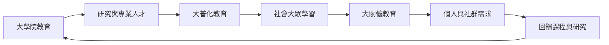

三大教育將專業人才培育、大眾理念推廣及整體關懷視為同一教育系統的不同環節。大學院教育提供知識與人才，大普化教育擴展社會接觸，大關懷教育則讓學習回應生活需求。此圖應與 [[三大教育形成專業人才普及教育與整體關懷的連鎖]]、[[法鼓山以學術教育作為組織發展的早期基礎]] 共同閱讀。

概念連結：[[三大教育]]、[[大學院教育]]、[[大普化教育]]、[[大關懷教育]]、[[佛教教育]]、[[法鼓文理學院]]、[[中華佛學研究所]]。
