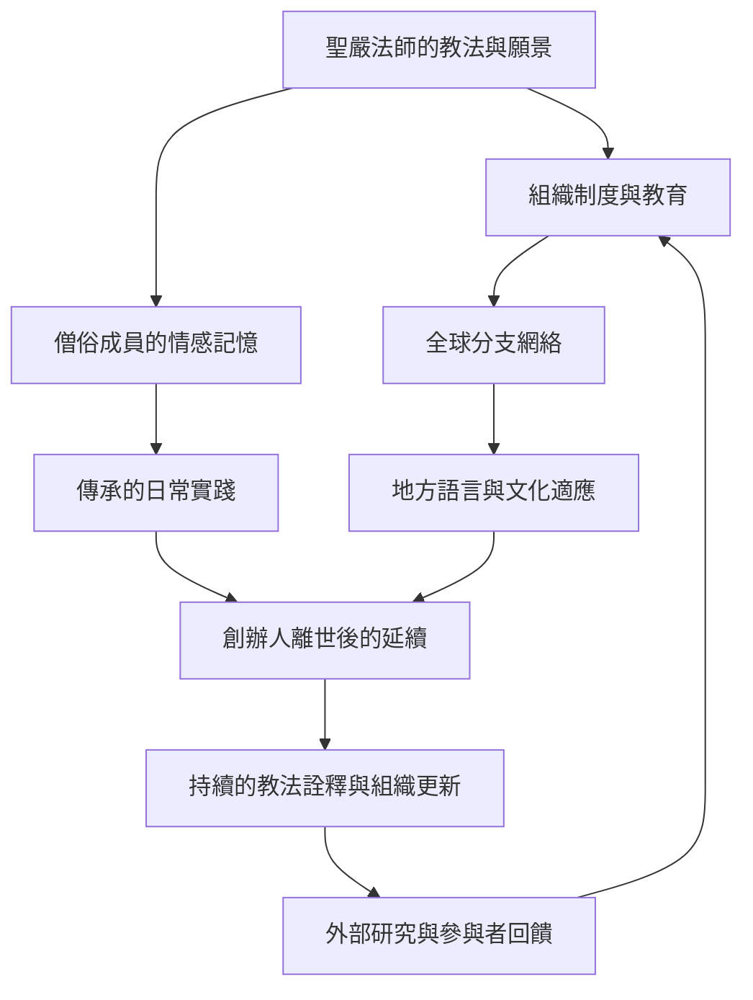

法鼓山的跨國網絡提供研究共同教法如何在地方實踐的機會；創辦人離世後的制度傳承，則需要從正式制度、情感承諾與日常實踐一起理解。研究時應區分官方自我敘述、學術研究、參與者經驗與外部成效資料。搭配 [[跨國佛教組織需要在共同傳承與地方適應之間協商]]、[[創辦人離世後的傳承依賴制度也依賴情感承諾]] 與 [[官方理念需要與組織實際成果分開評估]]。

概念連結：[[跨國佛教]]、[[宗教組織傳承]]、[[法鼓山]]、[[法鼓宗]]、[[佛教教育]]、[[佛教社會參與]]。
