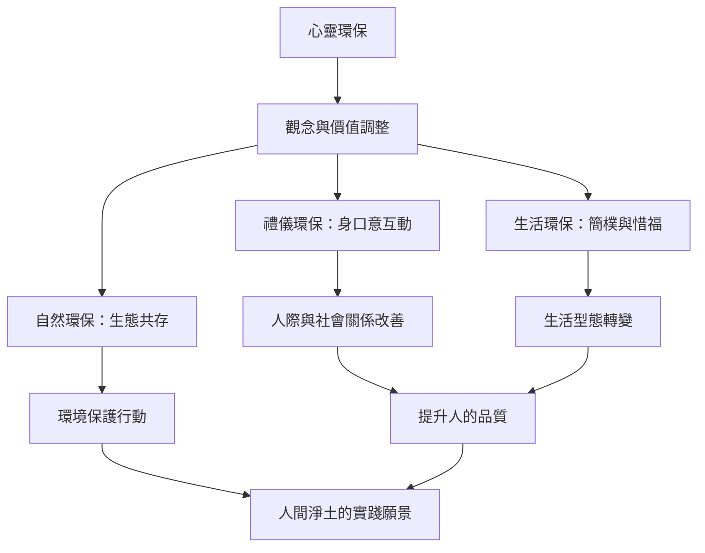

法鼓山的核心理念由心靈環保出發，經由人際倫理、簡樸生活及自然環境關懷，指向提升人的品質與建設人間淨土。這張圖呈現理念之間的關聯，不代表實際效果必然沿單一路徑產生。請搭配 [[法鼓山以提升人的品質作為人間淨土的實踐起點]]、[[四種環保將心靈修養擴展為生活與生態倫理]] 及 [[宗教環保成效需要以實際指標而非理念口號評估]]。

概念連結：[[心靈環保]]、[[四種環保]]、[[人間淨土]]、[[心五四]]、[[心六倫]]、[[佛教環境倫理]]、[[佛教社會參與]]。
