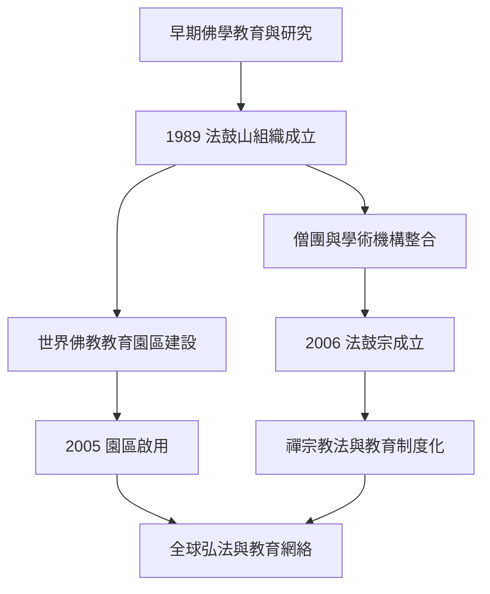

法鼓山的形成需要同時理解組織、教育、世界中心及法鼓宗的不同歷史層次。此圖以時間與制度關係呈現組織如何由早期佛學教育、1989 年組織成立，發展到 2005 年園區啟用與 2006 年法鼓宗建立。閱讀時可搭配 [[法鼓山的組織創立、園區啟用與法脈成立是不同歷史節點]]、[[法鼓山不是單一禪修中心而是僧團與教育機構的結合]] 與 [[法鼓宗的成立把禪宗傳承轉化為現代教育工程]]。

概念連結：[[法鼓山]]、[[聖嚴法師]]、[[法鼓宗]]、[[佛教教育]]、[[中華佛學研究所]]、[[法鼓文理學院]]、[[禪宗]]。
