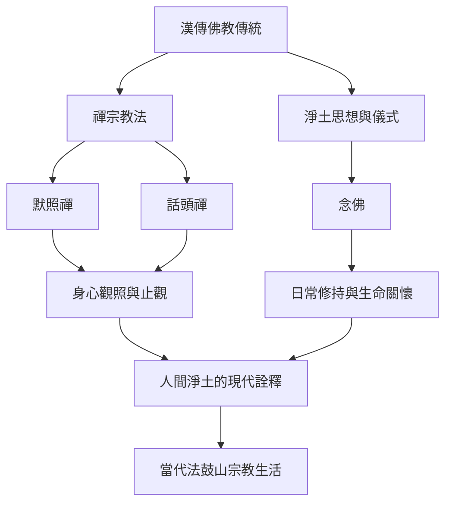

法鼓山的修行實踐不只包含禪修，也涵蓋念佛、淨土信仰、教理學習與日常倫理。聖嚴法師的禪學同時強調止觀、經典理解與教育；法鼓山內部的人間淨土論述，也與念佛等傳統實踐並存。可搭配 [[聖嚴法師的現代禪學不能被簡化為只重打坐]]、[[法鼓山的人間淨土與傳統淨土實踐彼此補充]] 和 [[現代佛教的改革需要同時觀察思想與儀式]]。

概念連結：[[禪宗]]、[[默照禪]]、[[話頭禪]]、[[淨土]]、[[念佛]]、[[人間淨土]]、[[聖嚴法師]]、[[法鼓宗]]。
