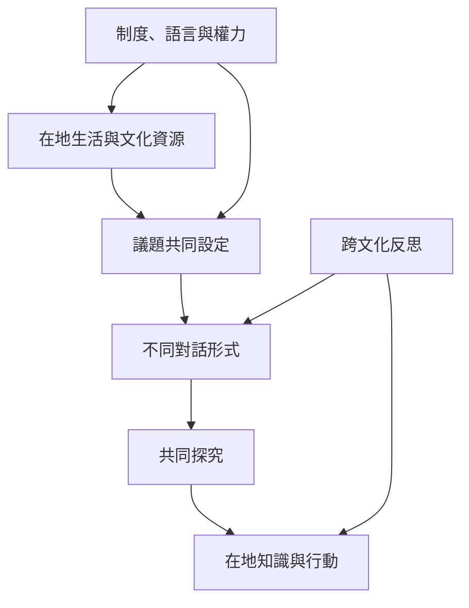

對話式學習在不同地區呈現不同實踐形式：巴西文化圈從生活議題出發；印度教育案例把異議與共同生活連結；南非 Ubuntu 取向關注社群知識與發聲權；中國藏族學校轉化口述詮釋與辯論傳統；中國課堂研究與印尼低社經學校案例則提醒制度與公平條件不可忽略。跨文化比較應保留差異，不將某地經驗說成全球通則。

建議先讀 [[note/對話方法必須依文化制度與參與條件調整]]，再讀巴西、印度、南非、中國與印尼案例。

## 參考
* [[data/解放教育把對話視為共同命名世界的實踐]]、[[data/印度教育者把異議與衝突視為共同生活的學習資源]]、[[data/Ubuntu取向的南非原住民教育強調社群知識與發聲權]]、[[data/藏族學校將傳統口述辯論轉化為當代課堂教學]]、[[data/印尼低社經課堂研究把對話視為教育公平的協商實踐]]。
