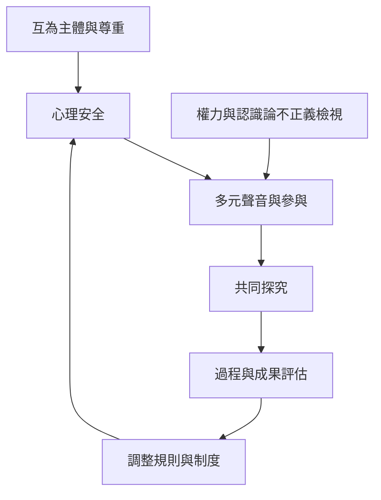

對話需要開放，但開放並不等於放任。心理安全、互為主體與多聲性支持參與者冒險提出想法；權力分析、認識論正義與方法反思則提醒我們，誰有發言權、誰被相信、誰定義結論，都會影響對話品質。評估應兼顧互動過程與學習成果。

建議閱讀 [[note/對話必須辨認權力差距才能談參與公平]]、[[note/對話的倫理基礎是承認參與者彼此具有主體性]]、[[note/對話學習的成效必須與互動過程一起評估]]。

## 參考
* [[data/對話式教學文獻仍需補足量化研究與方法多樣性]]、[[data/印尼低社經課堂研究把對話視為教育公平的協商實踐]]、[[term/認識論不正義使某些人的知識與證言較不被相信]]。
