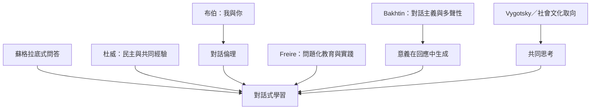

本圖整理對話式學習的主要思想來源：蘇格拉底式追問提供概念檢驗方法，Dewey 把溝通與民主共同生活連結，Buber 提供相遇倫理，Freire 把對話與解放實踐連結，Bakhtin 則說明意義如何在多聲與回應中生成。這些路徑相互呼應，但並非同一套理論。

進入路徑：先讀 [[note/對話式學習是共同建構意義而不只是輪流發言]]，再比較 [[data/杜威把民主理解為共同生活與經驗交流]]、[[data/解放教育把對話視為共同命名世界的實踐]] 與 [[data/巴赫汀的多聲性揭示理解來自不同聲音的相遇]]。

## 參考
* [[term/對話式學習把共同探究視為知識生成的過程]]、[[term/對話主義指出意義是在回應關係中形成]]、[[term/問題化教育讓學習者共同提出值得探究的問題]]。
