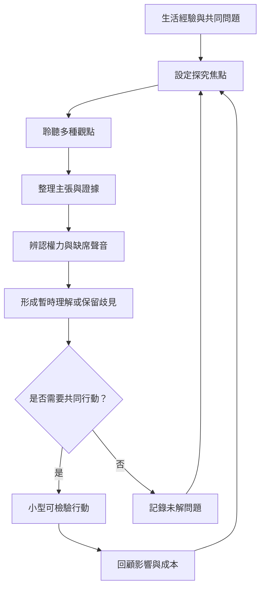

這張圖把理論轉成可操作流程。對話不是一定要走到行動，但若場域希望產生公共改變，就應讓問題設定、資料探究、異議處理、共同行動與回顧形成循環。每一步都要保留退出、不同意與重新定義問題的空間。

可搭配 [[idea/以三層提問把聊天轉化為共同探究]]、[[idea/建立一份對話品質觀察表而不把參與化約成發言量]] 與 [[note/對話必須連結反思與行動才不會退化成意見交換]] 使用。

## 參考
* [[data/解放教育把對話視為共同命名世界的實踐]]、[[data/聯合國教科文組織將跨文化對話視為社會凝聚能力]]。
