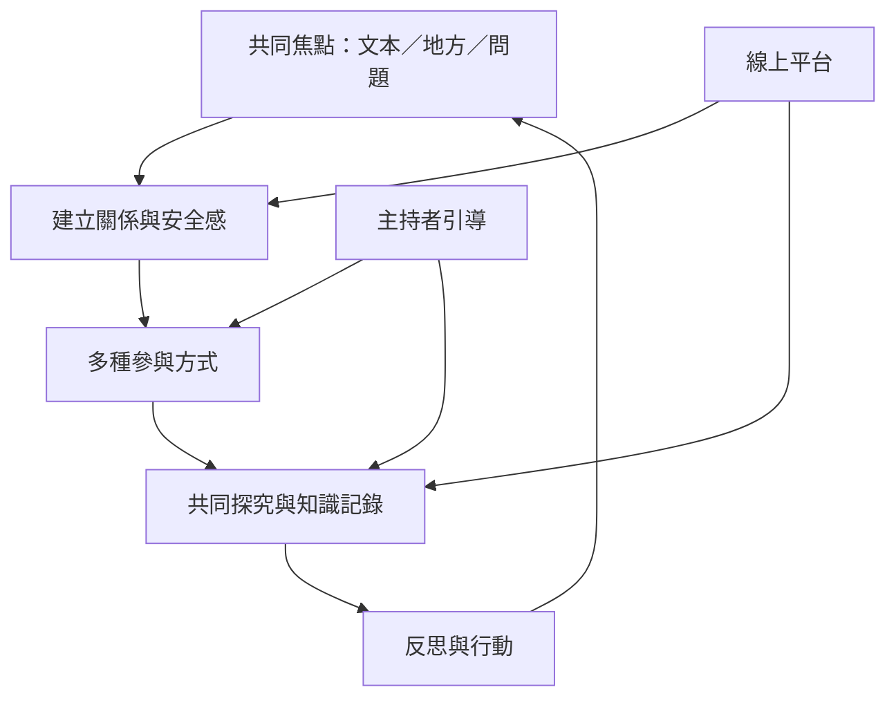

對話式學習不限於學校。線上探究社群需要認知、社會與教學臨場感；文學聚會以共同文本建立詮釋空間；共食、走讀與社區問題研究則讓生活經驗成為共同探究對象。關鍵在於建立可持續回應、共同記錄與行動回顧的關係。

可先讀 [[note/線上對話必須同時設計關係感探究與引導]]，再參考 [[idea/以對話式文學聚會讓經典閱讀成為平等共享的活動]]、[[idea/用共食與短暫靜默建立生活議題的對話圈]] 與 [[idea/把社區生活問題轉成共學者共同研究的小型行動]]。

## 參考
* [[data/線上探究社群由認知社會與教學臨場感共同構成]]、[[data/對話式文學聚會可擴大經典閱讀與參與機會]]、[[term/探究社群以共同批判探究與反思建構意義]]。
