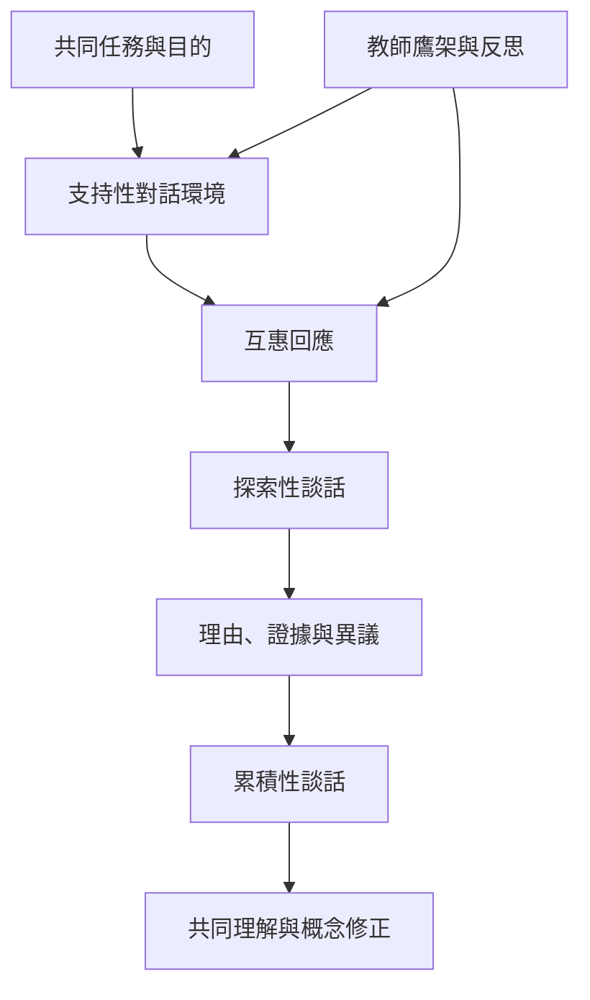

本圖聚焦教學設計與課堂實踐：教師安排共同目標與支持性規範，促成學生互相回應；探索性談話使理由可被檢驗，累積性談話使討論形成連續推理。教師不是退出，而是以鷹架協助更多學生進入探究。

建議閱讀 [[data/亞歷山大以六項原則設計高品質課堂對話]]、[[data/Mercer與Littleton說明集體對話如何發展兒童思考]]，搭配 [[note/對話的累積性比發言次數更能顯示共同思考是否發生]] 與 [[note/教師權威可以支架參與而不必壟斷意義]]。

## 參考
* [[term/對話式教學把談話設計成有目的的共同探究]]、[[term/探索性談話讓參與者以理由共同檢驗想法]]、[[term/累積性談話把彼此貢獻串成連續的共同推理]]。
