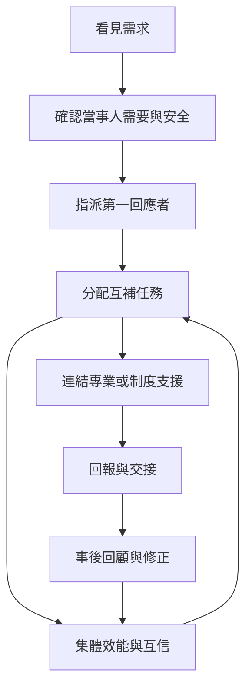

要改善責任分散，除了訓練個人的注意與介入技能，也要設計群體和制度如何承接任務。有效的集體照護由清楚角色、可行技能、互信、升級管道與事後回顧組成，並以受助者安全與自主作為評估中心。

將[[term/集體效能]]、[[term/旁觀者介入]]與[[term/道德責任]]轉化為[[note/責任共享需要角色互補而非責任稀釋]]、[[note/組織可用明確角色與升級路徑抵消責任分散]]及[[note/意圖與實際行為必須分開評估]]。實踐靈感可從[[idea/以「指名、任務、回報」改善集體照護]]、[[idea/鄰里危機應對練習建立低門檻介入]]與[[idea/以事後回顧檢查責任分散和傷害]]開始。

本卡片收錄於全書導讀 [[Diffusion_of_responsibility]]，可由主題脈絡回看此處。
