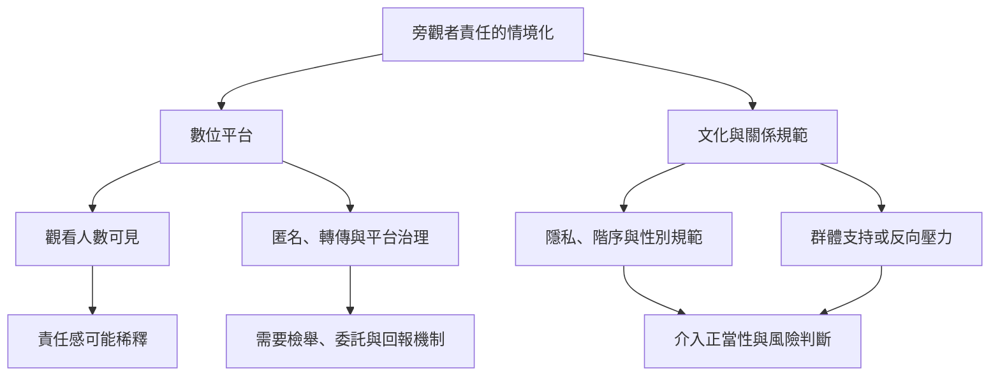

數位平台放大觀看人數與可見度，卻可能使責任變得更抽象；文化規範則影響人們認為何時介入正當、誰有權介入、介入可能帶來何種社會成本。這兩類情境都提醒我們，旁觀者理論需要放回具體的媒介與文化環境檢驗。

數位研究見[[data/線上霸凌的旁觀者數量會改變責任感與介入意圖]]；跨文化研究見[[data/親密伴侶暴力旁觀者介入必須考慮文化脈絡]]與[[data/英中比較顯示旁觀者責任感可能出現文化反轉]]。相關概念包括[[term/網路霸凌]]、[[term/群體規範]]及[[term/責任分散]]。

本卡片收錄於全書導讀 [[Diffusion_of_responsibility]]，可由主題脈絡回看此處。
