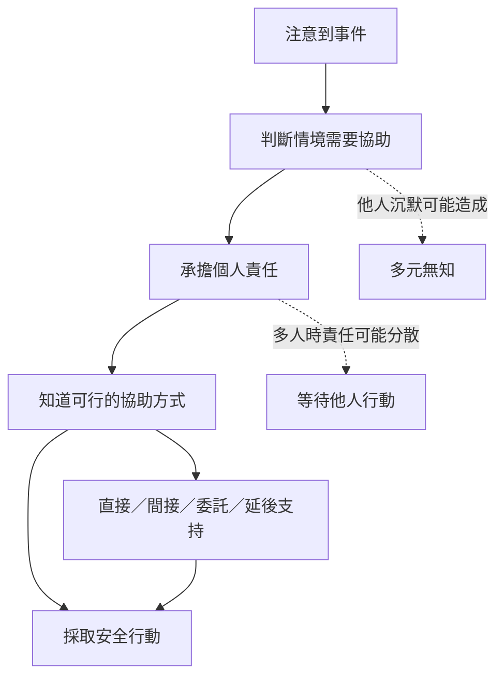

旁觀者不介入可能發生在行動鏈的不同位置。五階段模型把問題拆成可觀察、可改善的關卡：注意、判斷、承擔責任、知道如何幫助與實際行動。責任分散只解釋其中部分環節，不應取代完整診斷。

五階段模型將[[term/旁觀者效應]]與[[term/責任分散]]放進決策流程，也連結[[term/多元無知]]、[[term/評價焦慮]]與[[term/旁觀者介入]]。研究依據見[[data/他人在場會透過多種心理歷程抑制介入]]、[[data/五階段旁觀者介入模型把善意轉化為可練習的步驟]]。實務上可從[[note/求助決策可以拆成五個可介入階段]]和[[idea/建立安全的旁觀者介入微課程]]開始。

本卡片收錄於全書導讀 [[Diffusion_of_responsibility]]，可由主題脈絡回看此處。
