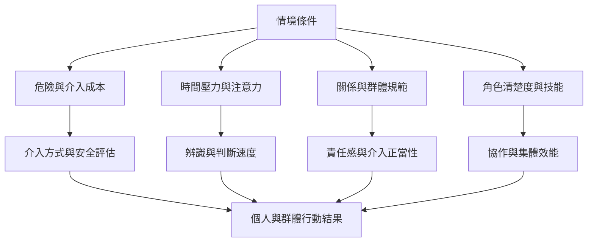

群體在場的作用會因事件危險程度、時間壓力、關係、技能、任務分工與制度支援而改變。更多人可能稀釋單一個人的責任，也可能增加群體可提供的支援。不要將「旁觀者數量」單獨當成足以預測結果的變項。

參照[[data/危險情境會削弱旁觀者效應但不會消除風險]]、[[data/時間壓力會縮窄注意並降低助人行為]]、[[data/真實公共衝突中旁觀者介入比傳說常見]]，並連結[[term/集體效能]]與[[term/群體規範]]。

本卡片收錄於全書導讀 [[Diffusion_of_responsibility]]，可由主題脈絡回看此處。
