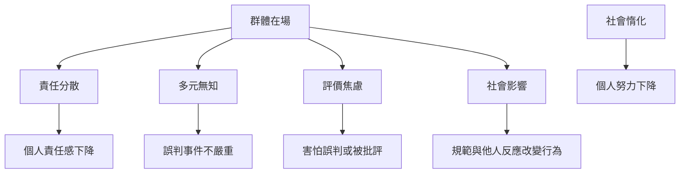

責任分散常和其他社會心理機制同時出現，但各自解釋不同環節：責任分散在問「誰應該負責」；多元無知在問「其他人怎麼看這件事」；評價焦慮在問「別人會怎麼看我」；社會惰化則在問「我的努力是否可辨識」。區分機制才能選擇適當的改善方法。

概念入口：[[term/責任分散]]、[[term/旁觀者效應]]、[[term/多元無知]]、[[term/評價焦慮]]、[[term/社會影響理論]]、[[term/社會惰化]]。對照[[note/責任分散必須與社會惰化區分]]及[[note/旁觀者效應不是群體冷漠的同義詞]]。

本卡片收錄於全書導讀 [[Diffusion_of_responsibility]]，可由主題脈絡回看此處。
