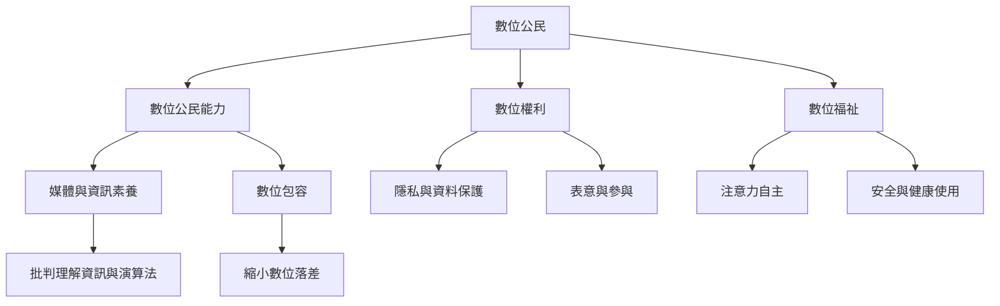

數位公民日常實踐由三個互相支撐的層面構成：使用數位工具的能力、行使人權與公民權的制度條件，以及維持自主與身心健康的生活安排。若只強調熟練度，可能忽略資源不平等；若只強調風險防護，則可能壓縮表意與參與。

## 關聯筆記
* [[term/數位公民]]、[[term/數位公民能力]]、[[term/數位權利]]、[[term/數位福祉]]
* [[term/數位落差]]、[[term/數位包容]]、[[term/媒體與資訊素養]]
* [[data/數位公民必須能持續而負責任地參與線上與線下社群]]
* [[data/數位能力框架把公民參與納入終身數位能力]]
* [[data/全球連網成長仍掩蓋所得性別與城鄉數位落差]]
* [[note/數位公民身分同時包含行動能力與制度權利]]
* [[note/數位接取只是起點實質參與還需要資源技能與可選擇性]]
* [[note/數位共融必須保留不被迫上線的公共服務選項]]
* [[idea/建立不以數位身分為門檻的社區數位互助台]]
* [[idea/把數位素養共學設計成互相教學而非能力排名]]
