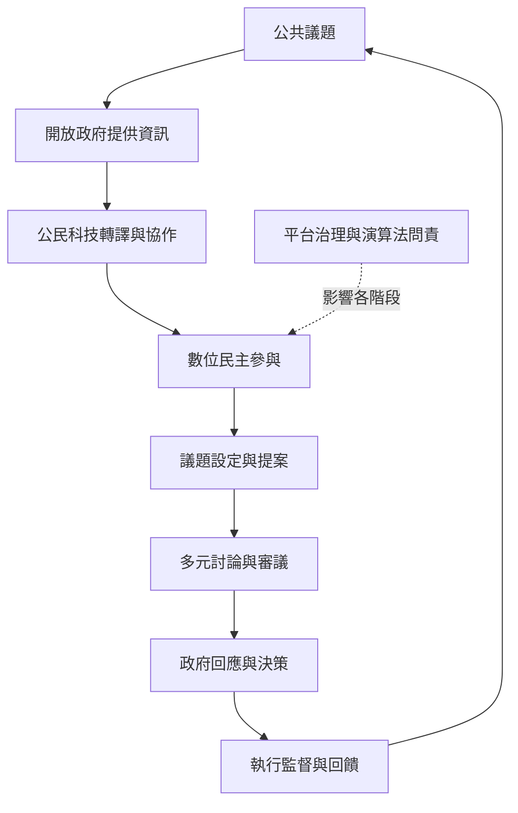

數位公民參與不應停留在按讚、投票或提交意見，而要讓公民有機會共同設定議題、參與討論、理解決策理由並追蹤執行。公民科技可以降低資訊取得與協作成本，但平台演算法和政府制度仍會影響哪些人、哪些意見能真正進入決策。

## 關聯筆記
* [[term/數位民主參與]]、[[term/公民科技]]、[[term/開放政府]]、[[term/平台治理]]、[[term/演算法問責]]
* [[data/台灣的公民科技把開放資料轉化為協作與公共監督能力]]
* [[data/數位參與平台的演算法會改變公眾如何被看見與分類]]
* [[note/數位參與的品質取決於議程設定決策影響與後續追蹤]]
* [[note/演算法不是中立管道而是塑造公共議題的制度]]
* [[note/公民科技的價值在於重組協作關係而非免費提供技術勞動]]
* [[idea/用社區議題共學建立小型公民科技協作]]
* [[idea/設計一份可追問平台演算法的公民檢核表]]
