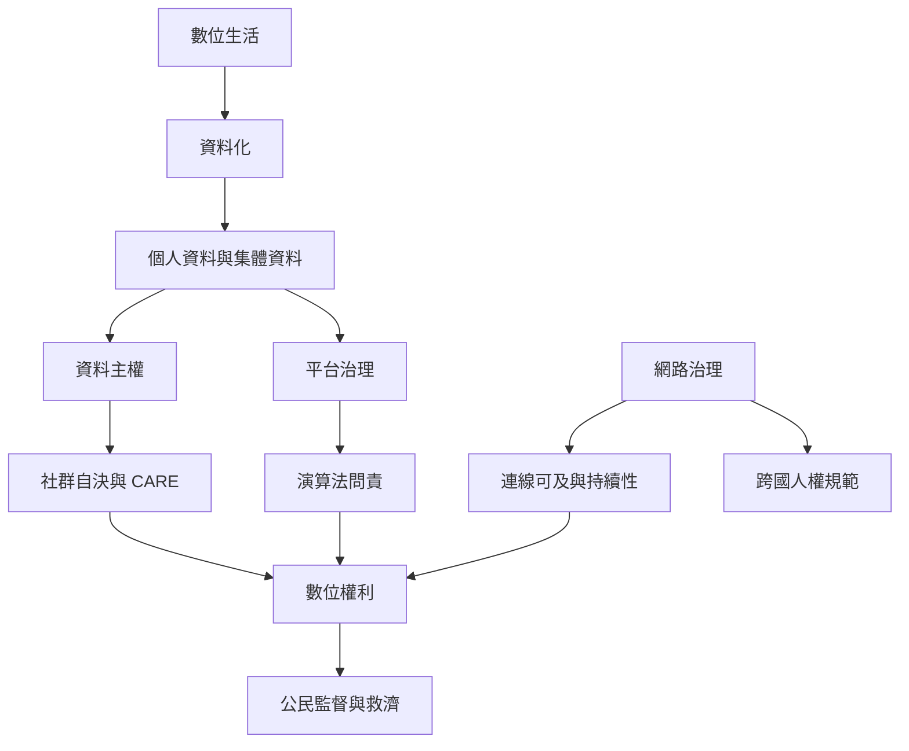

數位公民的自主並非只由個人設定決定，也受到資料蒐集、演算法分類、平台規則、網路可用性與政府數位服務設計影響。資料主權將社群納入決策，網路治理則把基礎設施與跨國規則帶入公共監督。這張地圖連結資料權力、制度問責與數位韌性。

## 關聯筆記
* [[term/資料化]]、[[term/資料主權]]、[[term/網路治理]]、[[term/數位權利]]、[[term/平台治理]]、[[term/演算法問責]]
* [[data/原住民族資料治理要求集體利益與自主控制]]
* [[data/數位政府的信任取決於資料治理與可驗證的問責]]
* [[data/網路中斷會直接切斷資訊教育與民主參與的條件]]
* [[data/全球數位契約把連線公平人權與人工智慧治理放進共同議程]]
* [[note/資料化讓公民同時成為行動者與被治理的對象]]
* [[note/資料主權必須讓社群參與決定資料用途與利益分配]]
* [[note/數位權利必須包含對基礎設施持續性的公共保障]]
* [[idea/建立個人與社群的資料流向地圖]]、[[idea/替社群知識建立共同資料治理約定]]
