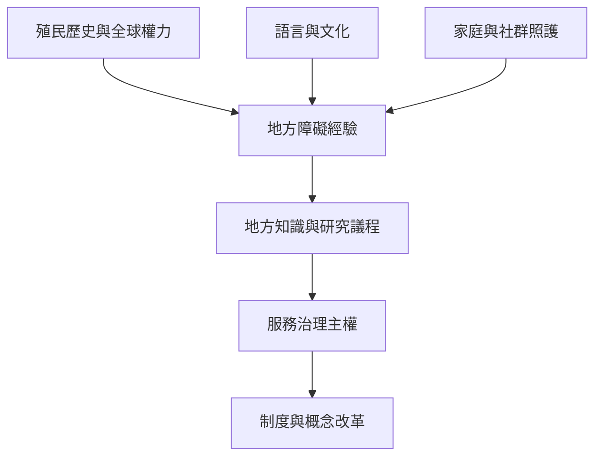

全球障礙研究需要避免把歐美理論當成普遍標準，再把其他地區變成案例。[[全球南方]]、[[原住民族]]、移民、聾人與其他社群，可能有不同的語言、照護、土地與服務治理脈絡。去殖民研究要求地方社群能定義問題、管理資料並主導制度。

重要入口：[[障礙研究]]、[[交織性]]、[[障礙正義]]、[[聾人文化]]。延伸閱讀 [[去殖民障礙研究必須承認地方知識與服務主權]]、[[全球南方障礙知識不應只是北方理論的應用場]] 及 [[障礙的去殖民化必須由原住民族掌握服務治理]]。
