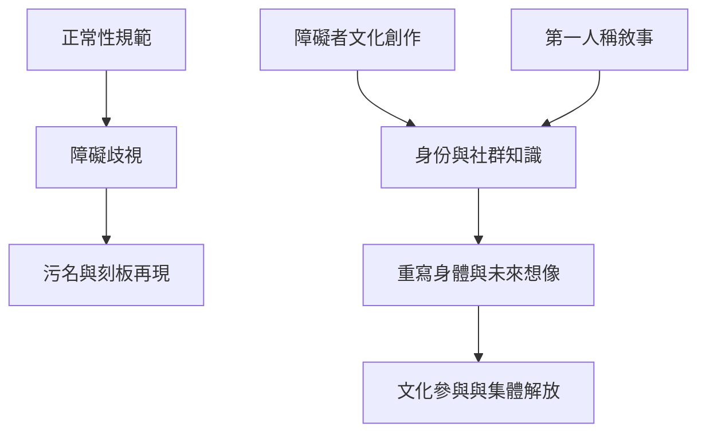

障礙者不是只在政策中被服務的人，也是文化創作者、語言社群、知識生產者與日常生活的主體。障礙文化、聾人文化、神經多樣性與 Crip 理論，會挑戰以健全、速度、獨立與生產力作為唯一標準的正常性。第一人稱敘事能呈現日常策略與社群差異，也需避免被剪輯成勵志消費。

概念入口：[[正常性]]、[[障礙歧視]]、[[障礙文化]]、[[勵志色情]]、[[聾人文化]]、[[神經多樣性]]、[[瘋狂研究]]、[[Crip理論]]、[[障礙時間]]。
