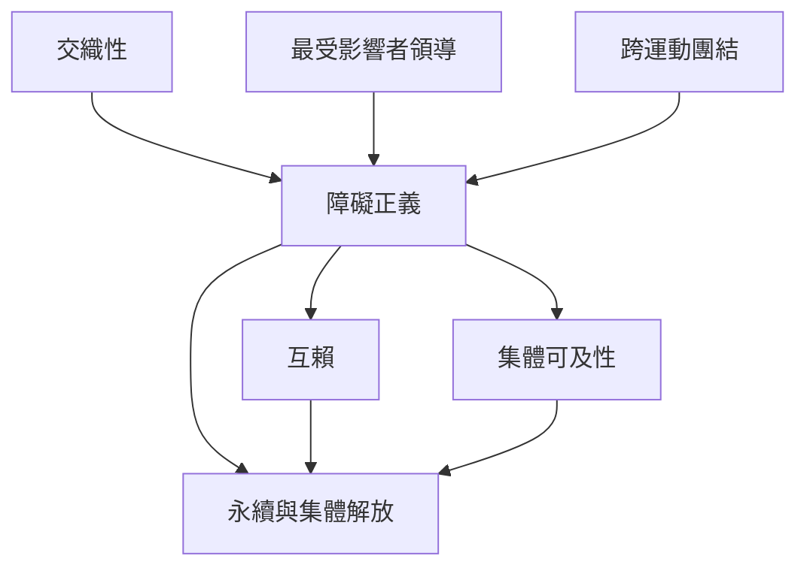

障礙正義從社群生存與集體解放出發，將障礙與種族、階級、性別、殖民及經濟制度連接。它不只要求個人被納入既有制度，也要求改變決策權、資源分配與日常互助方式。[[交織性]]呈現不同權力如何共同作用；[[互賴]]指出自主建立在關係與支持上；[[集體可及性]]將可及性變成共同實作。

核心概念包括 [[障礙正義]]、[[交織性]]、[[互賴]]、[[集體可及性]]、[[障礙時間]] 與 [[自主生活]]。可讀 [[障礙正義把平等從個別權利擴展為集體解放]]、[[互賴不是自主的反面而是自主得以實現的關係條件]]，並參考 [[障礙正義以交織性與集體可及性連結解放運動]]。
