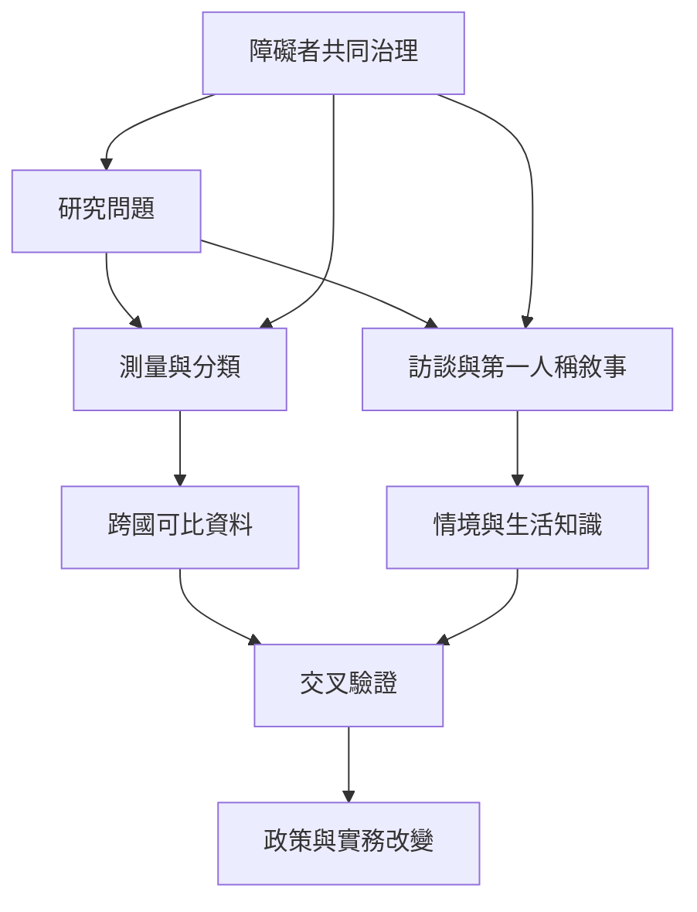

障礙研究的資料來源包括人口調查、行政資料、政策報告、訪談、第一人稱作品與社群行動。每種方法都會讓某些經驗變得可見，也會讓另一些經驗消失。跨國統計追求可比性，但短版題組可能無法涵蓋全部功能與生活經驗；障礙者主導研究則讓受影響者參與問題設定與知識治理。

方法入口：[[解放研究法]]、[[障礙者主導研究]]、[[第一人稱知識]]。重要議題見 [[身心障礙統計必須兼顧跨國可比性與經驗完整度]]、[[障礙者主導的研究能減少知識汲取與代言]] 與 [[第一人稱障礙敘事呈現社群內部差異與日常知識]]。
