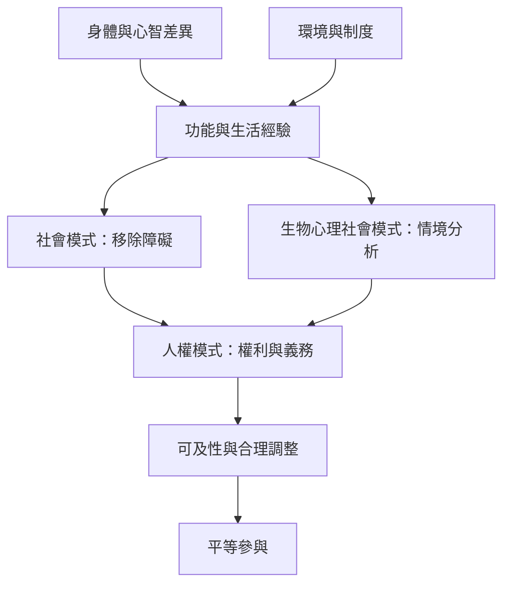

障礙研究從身體與心智差異出發，但不把診斷當成全部解釋。研究者需要同時理解環境如何製造限制、制度如何分配權利，以及不同理論能解釋與忽略什麼。[[社會模式]]揭露制度障礙，[[生物心理社會模式]]描繪多層次情境，[[人權模式]]指出權利義務；[[障礙研究]]則把這些理論放在社會運動與生活經驗中檢驗。

可沿著 [[身心障礙]]、[[身體損傷]]、[[社會模式]]、[[醫療模式]]、[[生物心理社會模式]]、[[人權模式]]、[[身心障礙者權利公約]] 閱讀；相關論證見 [[社會模式將障礙從個人缺陷重新定位為制度製造的限制]]、[[社會模式與身體經驗必須並置分析而不是互相否定]] 與 [[人權模式把可及性視為平等參與的必要條件]]。
