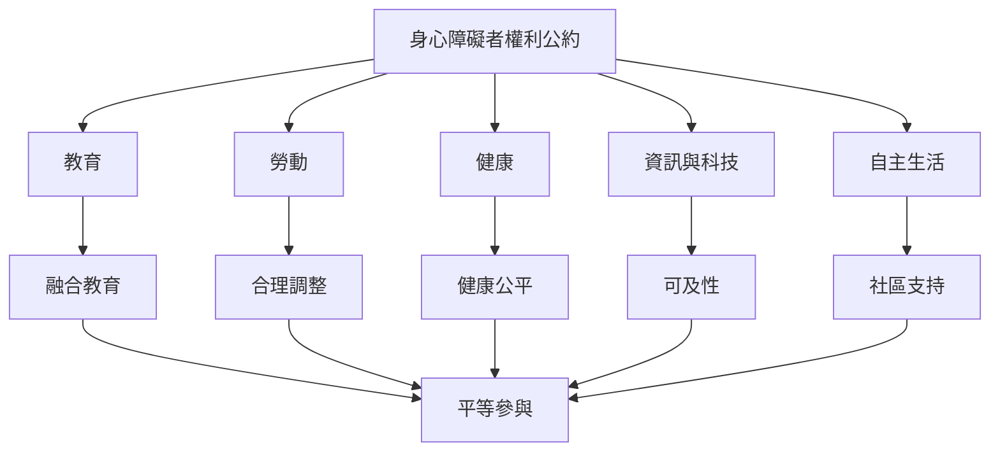

CRPD 將尊嚴、平等與參與落實到具體生活領域。教育需要系統性融合，勞動需要職場合理調整與公平薪酬，健康需要處理不平等照護，資訊與科技需要多模態可及性，自主生活則需要社區支持與選擇權。[[可及性]]、[[合理調整]]與[[通用設計]]是跨領域的實踐工具。

可參考 [[融合教育要求改造教育系統而非只改變學生所在位置]]、[[勞動平等需要改變職場結構而非只要求個人適應]]、[[多模態資訊讓公共溝通不再依賴單一感官管道]] 與 [[政策監督必須讓障礙者參與目標設定與成效評估]]。
