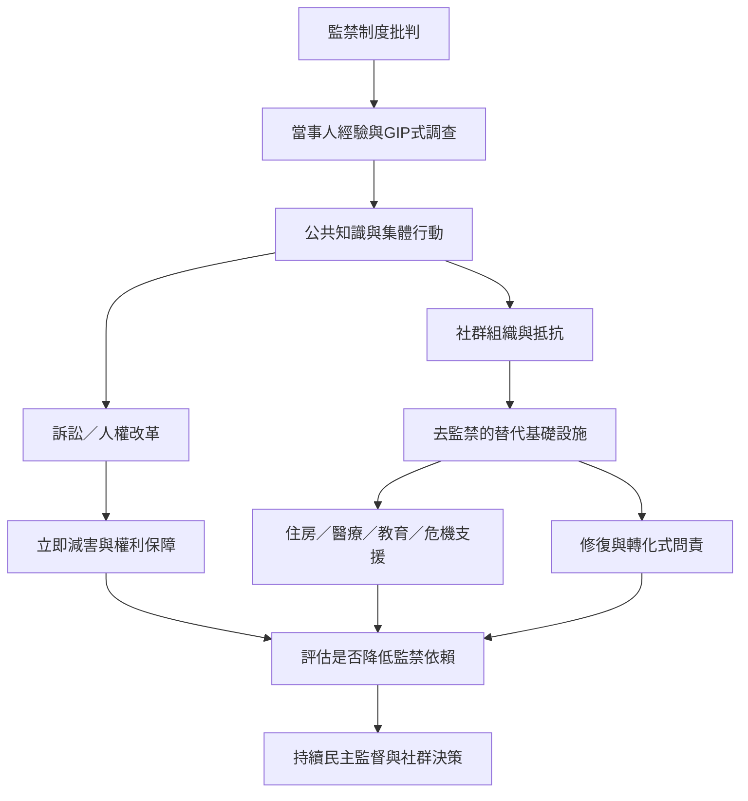

此圖從制度批判轉向政治行動：受刑人如何發聲、如何在法律和公共領域組織抵抗，以及如何建立不依賴監禁的安全和照護制度。改革與廢除並非同義詞，卻可以在減少當下傷害與長期轉型的策略中形成不同層次的工作。

延伸閱讀：[[監獄資訊小組把囚犯的經驗轉化為公共知識與政治行動]]、[[受規訓者不只是被動客體而會形成策略與抵抗]]、[[臺灣監獄改革透過訴訟與人權框架逐步推進]]、[[廢除監獄論述把福柯的制度批判延伸到社會替代方案]]。

概念節點：[[抵抗]]、[[反行為]]、[[廢除監獄主義]]、[[修復式正義]]、[[監獄學]]、[[治理術]]。
