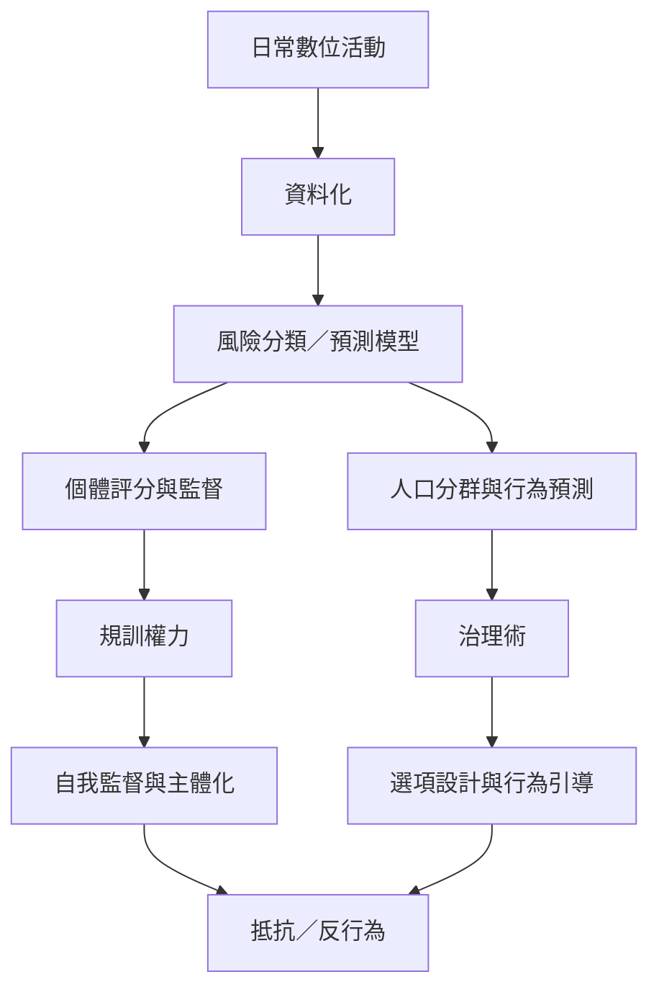

數位權力並非單純把監視塔搬進手機。資料抽取、分類與預測，會與介面設計、商業誘因及人口治理結合。此圖將個體層次的規訓與人口層次的治理術放在同一框架中。

延伸閱讀：[[預測演算法可以把風險分類延伸成新型規訓]]、[[數位監控把監視資本主義與主體塑造連結起來]]、[[規訓與治理術能解釋不同層次的數位權力]]、[[繪製個人數位生活中的資料蒐集與自我監督地圖]]。

概念節點：[[資料化]]、[[演算法治理]]、[[全景敞視主義]]、[[治理術]]、[[生命政治]]、[[權力／知識]]、[[種族化監控]]。
