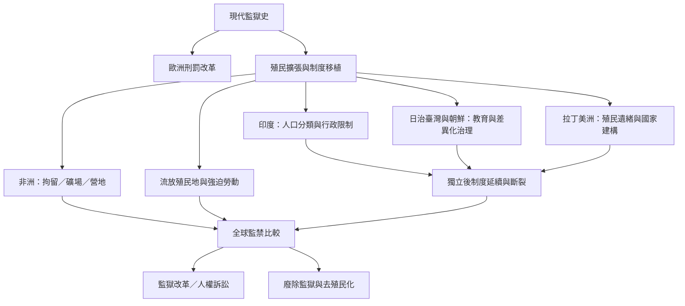

此圖把監獄史放回跨區域歷史：歐洲改革、殖民制度、強迫勞動、人口分類、地方國家建構與監獄改革彼此交錯。核心提醒是，不存在一條可適用所有地區的單一路徑。

延伸閱讀：[[全球監獄史必須納入殖民制度與地方差異]]、[[非洲殖民監禁同時涉及監獄營地礦場與領土控制]]、[[印度殖民刑罰制度在獨立後留下治理延續]]、[[日治臺灣與朝鮮監獄教育呈現帝國治理中的差異化規訓]]、[[拉丁美洲監獄現代化與殖民及國家建構交織]]、[[臺灣監獄改革透過訴訟與人權框架逐步推進]]。

概念節點：[[懲罰]]、[[監獄學]]、[[監禁社會]]、[[殖民性]]、[[監禁地理]]、[[身體政治]]、[[單獨監禁]]。
