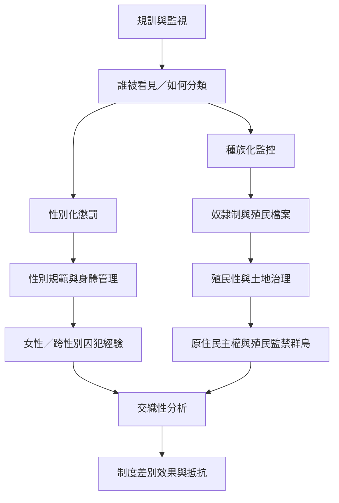

此圖以交織性為樞紐，連結種族化監控、性別化懲罰、殖民性與原住民主權。福柯的概念在這裡既是分析資源，也需要由黑人研究、女性主義、酷兒研究和去殖民研究加以修正。

延伸閱讀：[[種族化監控的歷史必須從奴隸制與黑人的日常生活讀起]]、[[女性與跨性別囚犯經驗揭示監獄規訓具有性別結構]]、[[女性監獄的全球研究顯示懲罰經驗不能只用男性樣本概括]]、[[殖民監獄群島把監禁與消滅原住民主權的治理連在一起]]。

概念節點：[[交織性]]、[[種族化監控]]、[[性別化懲罰]]、[[殖民性]]、[[身體政治]]、[[馴順的身體]]。
