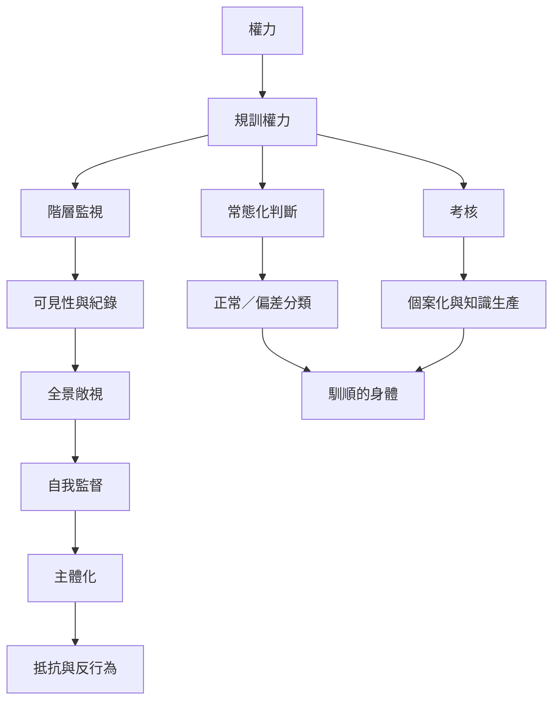

本圖從「身體如何被制度化地看見與比較」出發，串連監視、常態化判斷、考核、馴順身體與全景敞視。這些技術並非每次都同時出現，也不只存在於監獄；閱讀時要回到具體制度辨識其組合方式。

延伸閱讀：[[規訓權力透過日常程序而不是單一命令運作]]、[[監視分類與考核共同構成現代規訓的三種核心技術]]、[[全景敞視把不確定的監視轉化成自我監督]]、[[可見性分配本身就是一種權力關係]]、[[考核把個體轉化成可被研究與管理的個案]]。

概念節點：[[權力]]、[[規訓]]、[[規訓權力]]、[[階層監視]]、[[常態化判斷]]、[[考核]]、[[全景敞視]]、[[全景敞視主義]]、[[馴順的身體]]、[[權力／知識]]、[[主體化]]。
