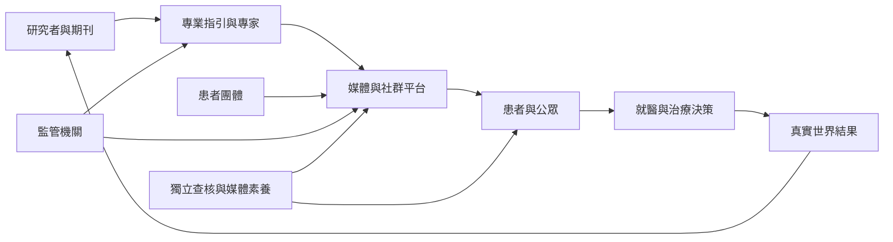

疾病資訊在媒體與社群中傳播時，應同時考察資訊品質、患者自主與監管制度。透明的資金關係、完整的風險溝通、獨立查核與患者參與，可以降低商業宣傳壟斷疾病敘事的可能。

相關筆記：[[媒體以危機敘事呈現疾病時容易放大未經核實的宣傳]]、[[患者團體需要資源也需要避免被資助者挾持議程]]、[[患者經驗可以修正商業批判的盲點]]、[[利益衝突必須透明揭露並接受獨立檢視]]、[[疾病新聞查核應追蹤原始研究與資助來源]]。

行動方向：[[設計一份不污名化患者的疾病宣傳查核卡]]、[[建立疾病新聞的五問法以降低恐懼式行銷]]、[[以患者敘事工作坊補足疾病行銷研究的單向批判]]。
