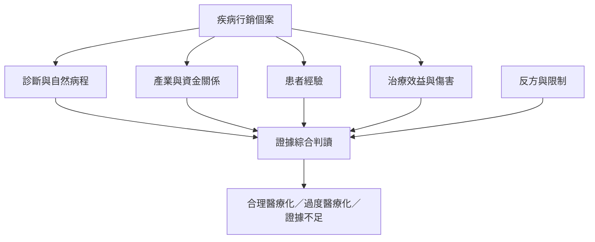

不同疾病案例展示了疾病行銷可能發生的多種方式，但各案例的證據強度與爭議程度不同。應把批判、患者經驗、臨床證據與反方論述放在一起，而不是用單一案例推論所有疾病。

案例：[[躁動不寧腿案例顯示疾病宣傳會借助媒體放大盛行率與療效]]、[[女性性功能障礙案例呈現疾病分類與女性主義倡議之間的拉鋸]]、[[勃起功能障礙案例顯示藥品行銷可以重新定義治療需求]]、[[注意力不足過動症案例要求區分兒童需求與制度性推廣]]、[[低睪固酮行銷揭示監管機關與產業之間的邊界問題]]、[[骨質疏鬆症行銷案例應同時閱讀批判論文與當代臨床證據]]。

平衡閱讀：[[醫療化有好壞之分不能與疾病行銷畫上等號]]、[[疾病行銷批判也可能過度延伸而忽略真實疾病]]、[[患者經驗可以修正商業批判的盲點]]。
