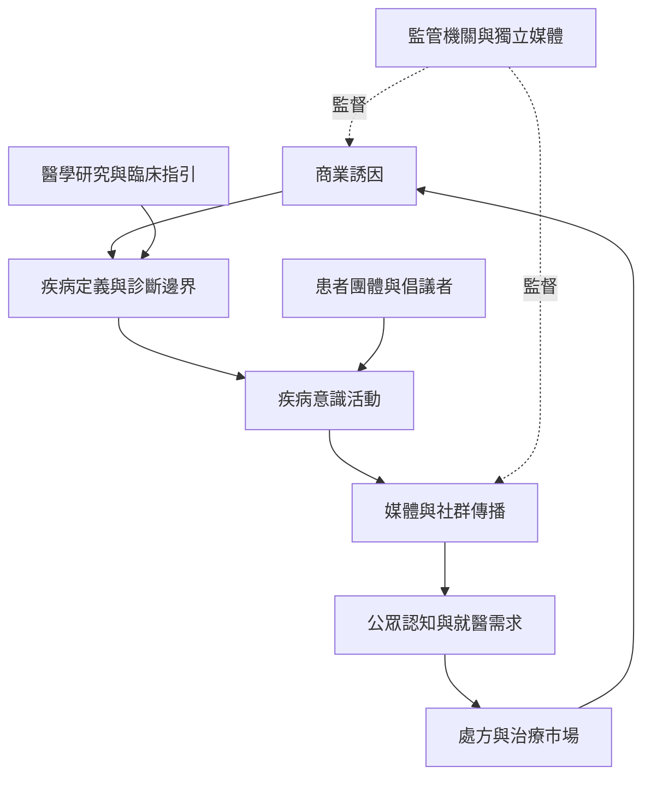

疾病行銷不是單一廣告事件，而是疾病分類、研究證據、專家權威、患者倡議、媒體敘事與藥品市場之間互相強化的過程。閱讀時可從概念、行動者與證據流三個層次切入。

核心概念：[[疾病行銷]]、[[醫療化]]、[[藥物化]]、[[疾病意識活動]]、[[直接面向消費者廣告]]、[[利益衝突]]。

案例與研究：[[疾病行銷是擴張可治療疾病邊界以擴大市場的過程]]、[[疾病意識活動可能在教育公眾時同步擴張治療市場]]、[[印度學生調查把疾病行銷議題帶入藥品銷售制度]]、[[紐西蘭2025年回顧指出處方藥廣告有益處也有市場扭曲風險]]。

延伸思考：[[替每一場疾病宣傳建立一張利益透明地圖]]、[[將疾病行銷素養納入健康教育與媒體識讀]]。
