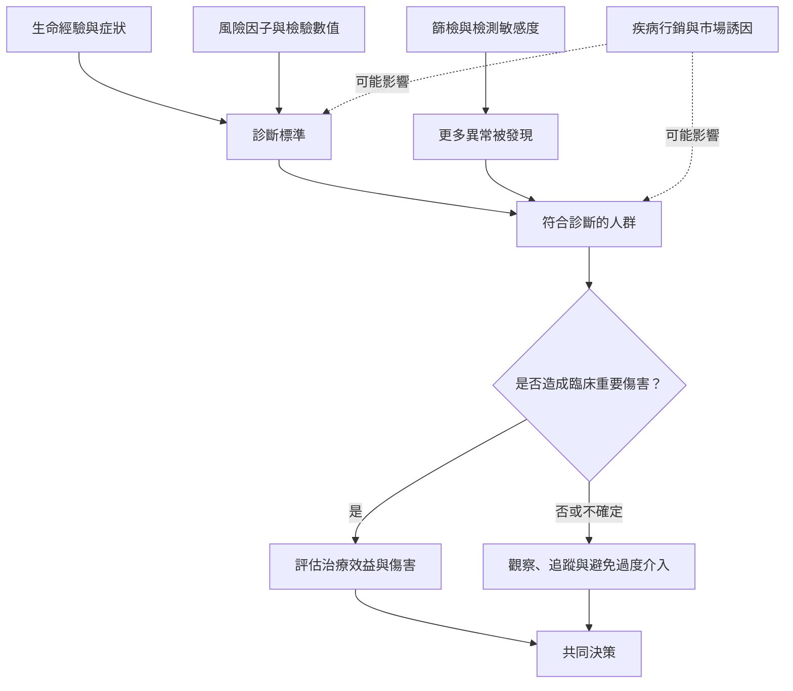

本圖聚焦疾病分類本身：診斷標準如何設定、風險因子如何變成治療目標、篩檢如何提高檢出，以及何時可能出現過度診斷與過度治療。

核心概念：[[診斷標準]]、[[風險因子]]、[[篩檢]]、[[過度診斷]]、[[過度治療]]、[[絕對風險]]、[[相對風險]]、[[治療需治人數]]。

相關永久筆記：[[把風險因子當成疾病會讓預防與治療的界線變得模糊]]、[[盛行率數字必須連同定義與分母一起閱讀]]、[[篩檢可能同時帶來早期發現與過度診斷]]、[[疾病行銷擴張的是可治療疾病的邊界而不一定是憑空創造疾病]]。

延伸實作：[[做一張疾病定義變遷時間軸追蹤診斷門檻如何移動]]、[[為每種治療方案呈現受益與傷害的同一張圖]]。
