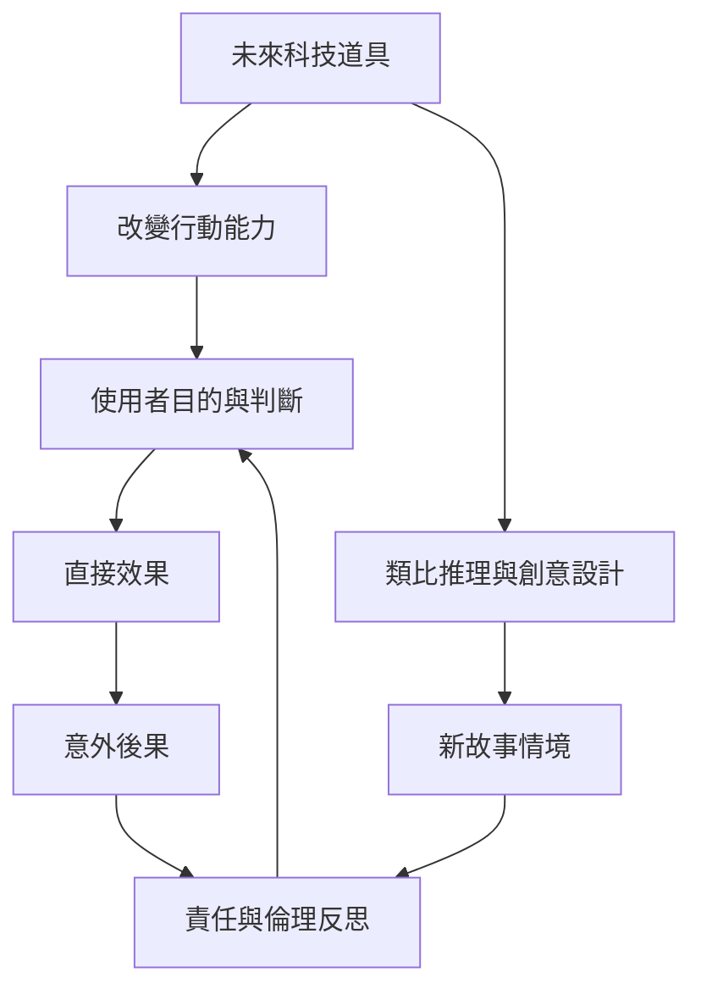

本概念地圖從「道具如何改變日常」出發，整理科技能力、使用者判斷與故事後果之間的關係。道具不是價值中立的萬能解答；它們會改變角色的可行動範圍，也把目的、責任、同意與風險放大。

核心連結：[[道具不是答案，而是放大使用者判斷的試驗場]]、[[哆啦A夢把未來科技帶入日常以呈現技術倫理]]、[[哆啦A夢道具設計可拆解為類比與問題重構的創造流程]]、[[科技倫理]]、[[技術中介]]、[[四次元口袋]]、[[任意門]]、[[時光機]]、[[類比推理]]、[[科幻]]。
