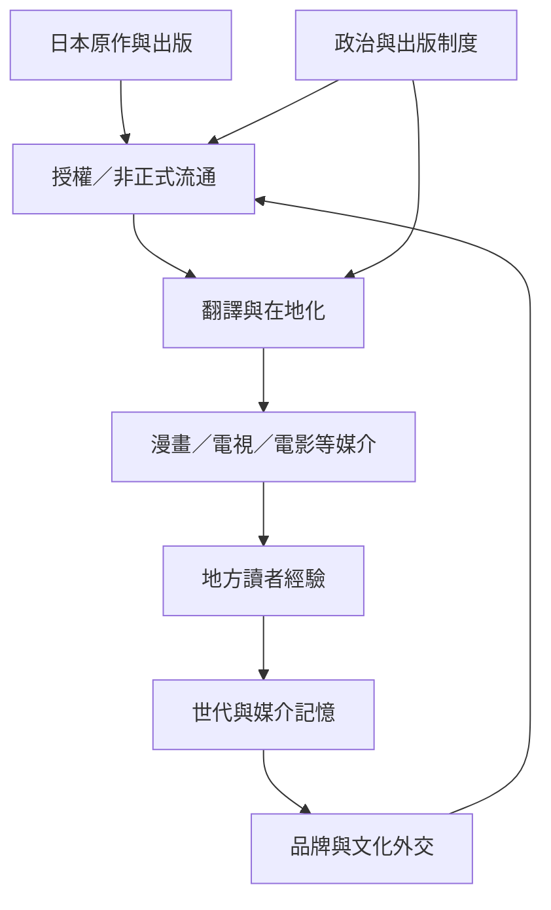

作品的跨境傳播由多種中介共同構成：原作與授權、翻譯與出版、電視與電影、地方歷史、讀者社群及商品市場。跨國流通並非單向輸出；讀者與地方機構會重新命名、詮釋並賦予作品新的意義。

核心連結：[[哆啦A夢的跨文化生命由翻譯、出版與地方記憶共同塑造]]、[[哆啦A夢的懷舊是被媒介共同組織的共享記憶]]、[[作品如何同時承載普遍情感與地方社會想像]]、[[哆啦A夢的公益價值必須同時檢視資源流向與地方主體性]]、[[在地化]]、[[跨國文化流動]]、[[文化冷戰]]、[[媒介記憶]]、[[文化軟實力]]、[[文化商品化]]、[[翻譯]]、[[口述歷史]]。
