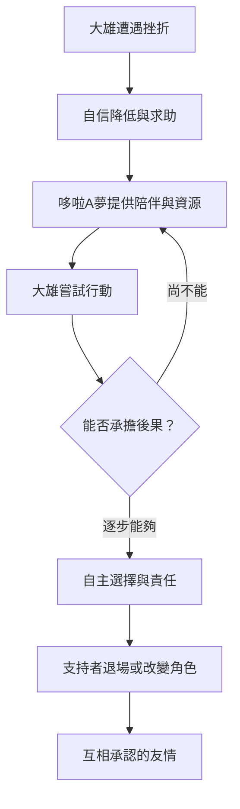

本概念地圖呈現哆啦A夢如何以支持者身分協助大雄，又如何在故事關鍵時刻讓大雄自己採取行動。支持並非永久代勞，而是回應需要、承認脆弱、共同練習並逐步交還選擇權的關係過程。

核心連結：[[大雄的成長來自支持關係逐步轉化為自主行動]]、[[家庭支持既能安撫也可能延宕自立]]、[[友情是一種共同承擔而非單向拯救]]、[[互助不應取代對方的主體性]]、[[支持關係]]、[[兒童主體性]]、[[照顧倫理]]、[[互助]]。
