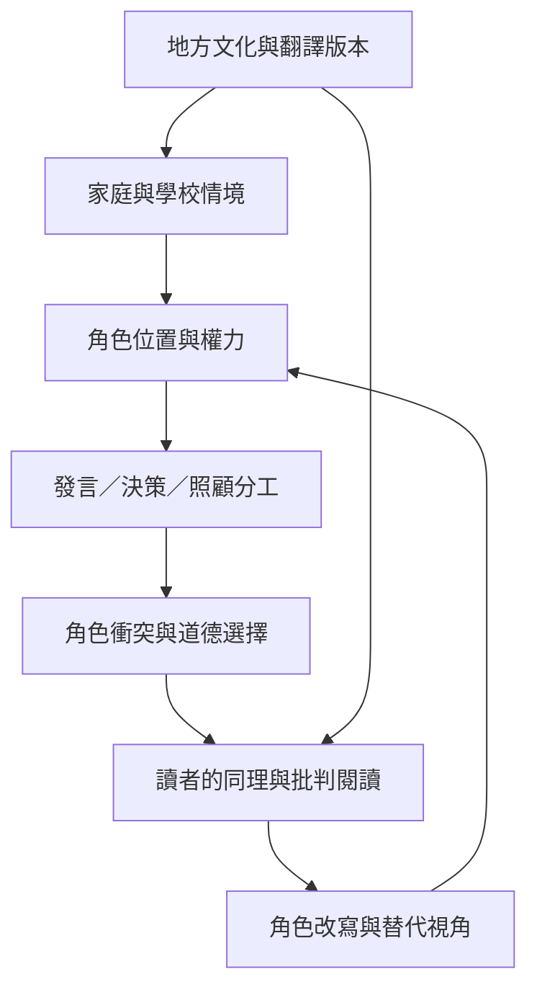

本概念地圖把角色互動、家庭倫理、性別分工與兒童主體性放在同一張關係網中。分析時應從具體情節出發，不把角色類型直接等同真實社會，也不把讀者感受當成作品造成行為改變的因果證據。

核心連結：[[作品中的性別與角色分工需要放在具體情節中重新檢視]]、[[反覆失敗讓兒童能在低風險情境中練習道德判斷]]、[[閱讀者能從哆啦A夢的情節練習提出問題而非只接受結論]]、[[作品呈現普世童年困境，也保留日本社會的文化位置]]、[[角色類型]]、[[兒童主體性]]、[[道德想像]]、[[照顧倫理]]。
