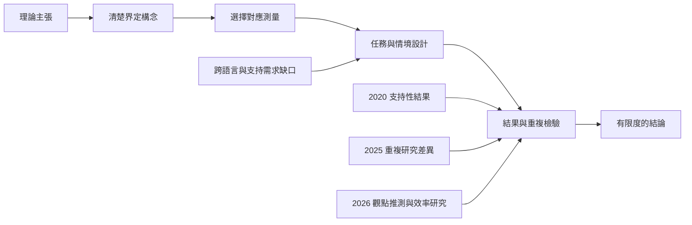

雙重同理問題的經驗研究並非一致支持單一預測。支持性研究指出同神經類型互動的融洽感或自陳偏好可能較高；重複研究與 2026 年任務研究則對資訊效率或觀點推測提出不同結果。方法學評論提醒，資訊傳遞與融洽感不可直接等同認知或情感同理心；跨語言、跨文化及不同支持需求樣本仍不足。

概念入口：[[同理心]]、[[認知同理心]]、[[情感同理心]]、[[人際融洽感]]、[[資訊傳遞]]。

爭論文獻：[[雙重同理研究需要補強概念推導鏈]]、[[2026年方法學回顧指出現有研究未直接測量多數同理心]]、[[2025年大型重複研究沒有重現資訊傳遞差異]]、[[2026年同理準確度研究未支持同類型者更能讀懂彼此]]、[[2026年合作參照任務未發現同神經類型溝通更有效率]]。
