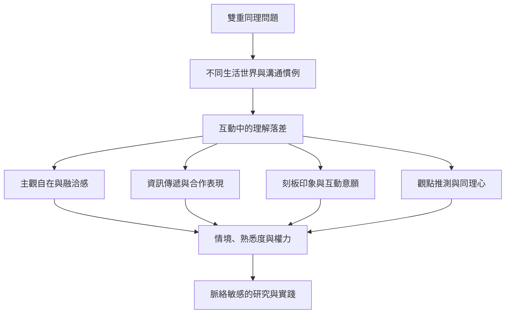

雙重同理問題以關係性觀點重新理解跨神經類型互動。理論起點是不同生活世界與社會期待造成互惠性理解落差；後續研究分別檢視融洽感、資訊傳遞、第一印象、自陳偏好與實際觀點推測。讀圖時要區分概念層次與測量指標。

概念入口：[[雙重同理問題]]、[[神經類型]]、[[神經多樣性]]、[[互為主體性]]、[[同理心]]、[[認知同理心]]、[[情感同理心]]。

核心文獻：[[雙重同理問題把自閉者互動困難重新定位為關係失配]]、[[自閉者彼此能透過獨特互為主體性建立共同理解]]、[[神經類型匹配會影響互動融洽感]]、[[自閉者彼此的資訊傳遞可與非自閉者相當]]。
