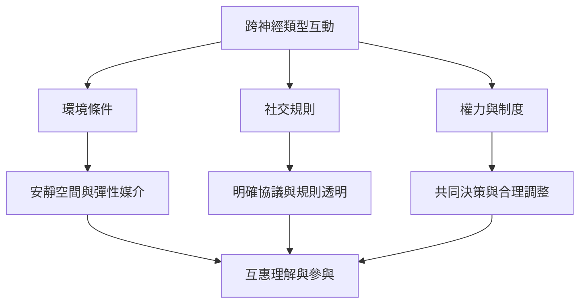

理解不是只靠個人努力產生，也受感官環境、溝通媒介、社交規則與權力關係影響。實踐的重點不是要求某一方更像主流，而是讓互動規則可見、可協商，並讓雙方分擔理解與調整的工作。

概念入口：[[社交迷彩]]、[[普遍設計]]、[[社會模式與關係性障礙]]、[[人際融洽感]]。

實踐筆記：[[環境與感官條件會改變跨神經類型互動品質]]、[[權力差異會使雙向失配承受不對稱後果]]、[[研究參與者的語言與支持需求限制了理論的普遍化]]。

行動入口：[[在開始重要對話前共同設定溝通協議]]、[[以低感官負荷與非同步通道擴大理解空間]]、[[把自閉者納入溝通制度與研究設計的共同作者]]。
