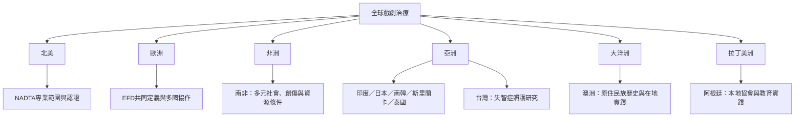

全球戲劇治療需要同時看專業制度與在地實作。地區不是分類標籤，而是歷史、法律、文化與社會服務條件的集合。

此圖是文獻入口，不代表每一地區的專業成熟度或完整現況。跨國書籍章節所列的十四個地理區域可作為追蹤清單；其中新書預計 2027 年 2 月出版，需待出版後再核對細節。

## 雙向連結
* [[全球戲劇治療地圖呈現制度差異與在地轉化]]；[[全球戲劇治療專書預告以十四個地理區域呈現六大洲實務]]
* [[南非研究呈現戲劇治療必須回應多元社會與制度條件]]；[[台灣失智症研究把戲劇治療帶進高齡照護脈絡]]；[[歐洲戲劇治療共同定義強調互動創造遊戲與健康]]
