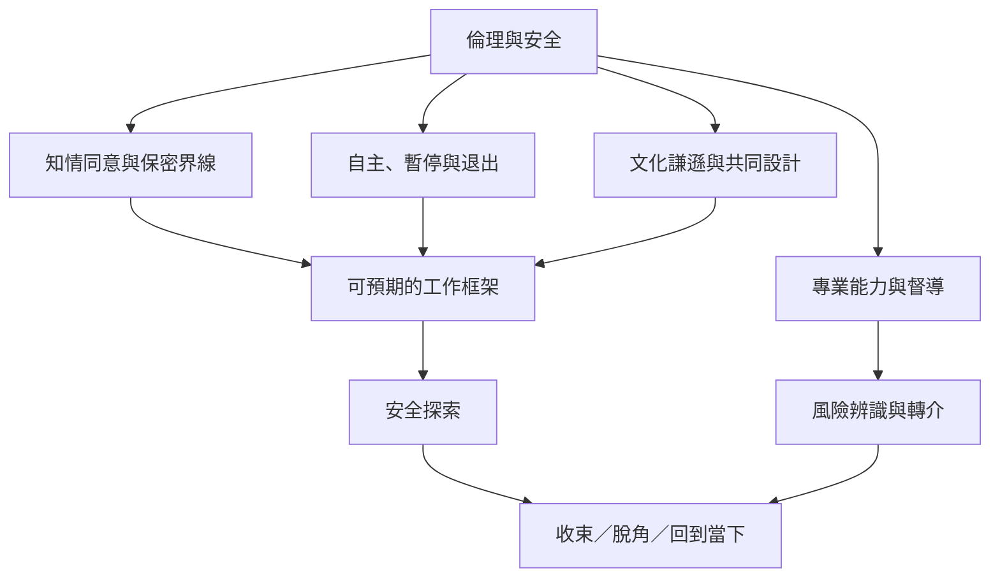

戲劇治療涉及身體、情緒、角色、故事與團體關係，倫理不是活動結束後才補上的規定，而是設計本身的一部分。

文化適切性、專業責任與參與者自主必須同時成立。安全並不等於沒有情緒，而是參與者知道自己有選擇、可被尊重且有適當支持。

## 雙向連結
* [[創傷知情]]、[[參與者自主]]、[[治療關係]]、[[文化適切性]]、[[脫角]]
* [[為創傷知情戲劇工作設計可退出的安全架構]]；[[專業訓練與倫理界線決定戲劇工作能承擔什麼責任]]
