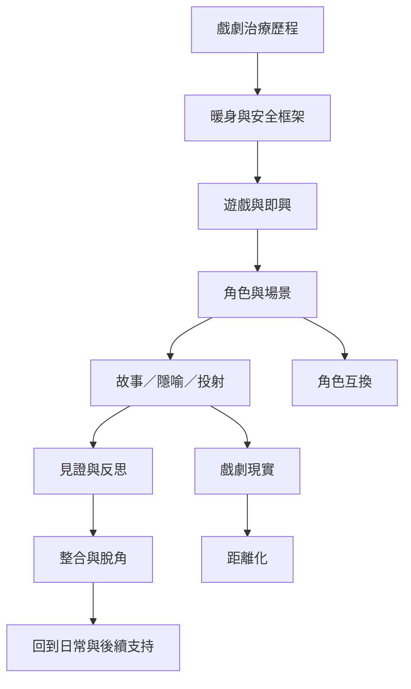

不同戲劇治療取向會以不同方式組合技術。這張地圖以核心歷程整理，而非提供標準化教案。

技術的選擇應服務參與者與目標，且需考慮年齡、文化、身體狀態、感官需求與創傷脈絡。

## 雙向連結
* [[五階段整合模式]]、[[即興]]、[[戲劇遊戲]]、[[角色方法]]、[[故事與隱喻]]、[[戲劇投射]]、[[脫角]]
* [[五階段整合模式把暖身角色工作與整合連成歷程]]；[[安全收束與脫角讓參與者重新回到日常脈絡]]
