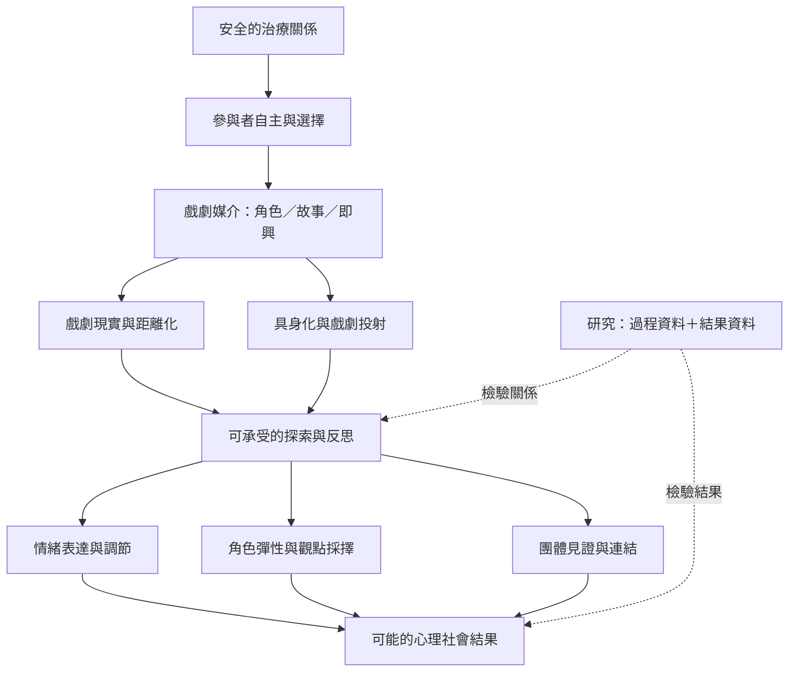

戲劇治療的改變機制不宜簡化為「演出情緒就會痊癒」。較有用的模型，是把戲劇媒介、參與者即時經驗、治療關係與可觀察結果放在同一個動態系統中。

上圖是待檢驗的理論綜合，而非已被證實的單一路徑。不同參與者、媒介與文化情境可能產生不同機制，也可能有負面或無效經驗。

## 雙向連結
* [[戲劇現實]]、[[戲劇投射]]、[[距離化]]、[[具身化]]、[[主動見證]]、[[治療關係]]、[[參與者自主]]
* [[戲劇治療的作用機制需要由過程資料與結果資料共同檢驗]]；[[戲劇治療的證據應依介入類型與研究設計分層解讀]]
