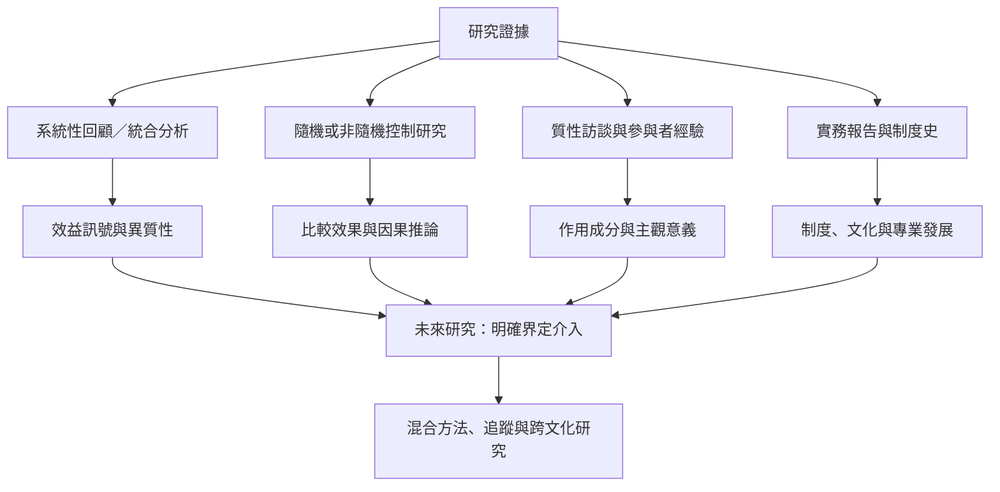

目前證據包含兒少系統性回顧、兒少質性經驗統合、成人團體回顧、不同人群的個別研究，以及納入多種戲劇介入的統合分析。各類研究回答不同問題，不能被當作同一證據池。

目前重要缺口包括：介入名稱與內容不一致、樣本小、追蹤期短、治療師能力與介入忠實度報告不足、參與者聲音不夠，以及全球南方與非英語研究較難被納入國際資料庫。

## 雙向連結
* [[兒少戲劇治療系統性回顧呈現正向訊號但證據量仍小]]、[[兒少參與者能指出戲劇治療的六類作用成分]]、[[成人團體戲劇治療回顧指出自信韌性與社會連結值得研究]]
* [[廣義戲劇介入統合分析呈現潛力也暴露證據異質性]]、[[戲劇治療的證據應依介入類型與研究設計分層解讀]]
