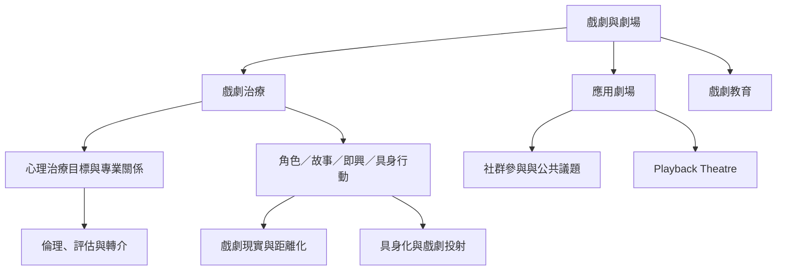

戲劇治療位於心理治療、表演藝術、遊戲、敘事與社會實踐的交會處。理解領域時，應把「共同使用戲劇形式」與「具有相同專業目標」分開。

戲劇治療與心理劇、社會劇、治療性劇場可能互相借用方法，但各自有不同理論史與專業社群。判斷一個方案屬於哪一類，不應只看活動形式，也要看帶領者資格、治療意圖、責任邊界及評估方式。

## 雙向連結
* [[戲劇治療]]、[[心理劇]]、[[社會劇]]、[[應用劇場]]、[[治療性劇場]]、[[Playback Theatre]]
* [[戲劇治療的核心不是演技而是有意圖的戲劇歷程]]；[[戲劇治療與應用劇場必須清楚區分]]
