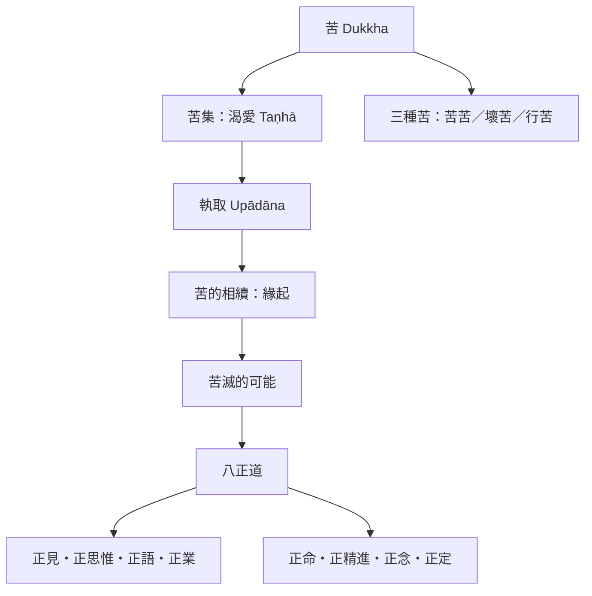

這張地圖以早期佛教的四聖諦為骨架，將 Dukkha、苦集、苦滅與修道連成一條辨識—理解—實踐的路徑。

* [[Duḥkha（Dukkha／苦）]]
* [[四聖諦（Ariyasacca）]]
* [[渴愛（Taṇhā）]]
* [[執取（Upādāna）]]
* [[緣起（Paṭiccasamuppāda）]]
* [[八正道（Ariya-aṭṭhaṅgika-magga）]]
* [[苦的三層分類區分直接苦變易苦與行苦]]
