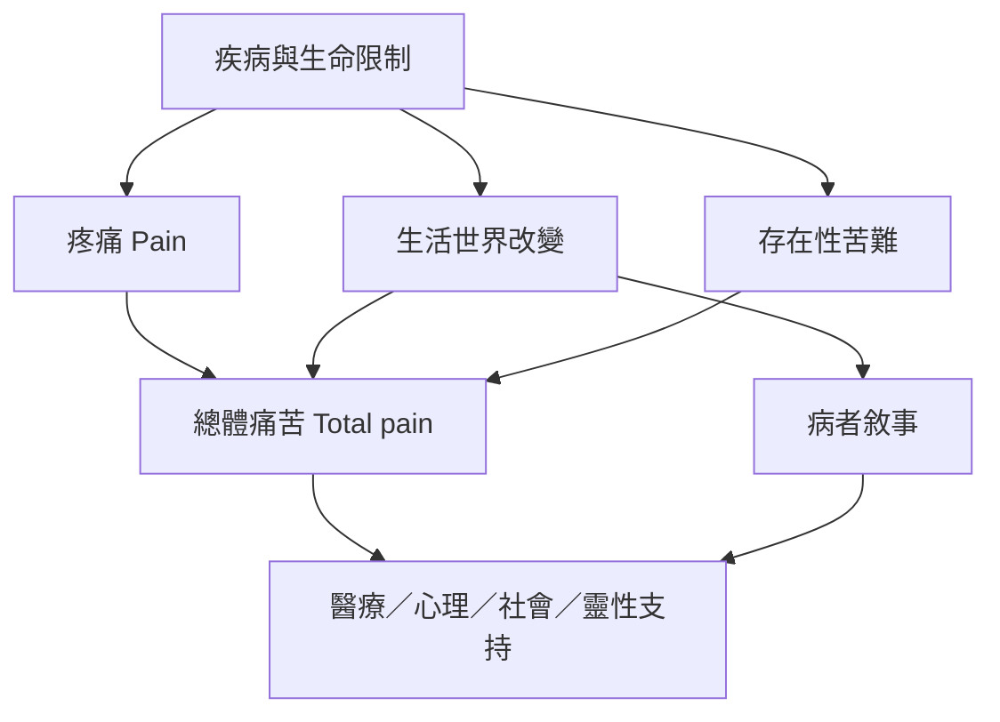

此圖以病人經驗為中心，連結疼痛、總體痛苦、疾病現象學、敘事與存在性議題，呈現跨專業照護的可能性。

* [[疼痛（Pain）]]
* [[總體痛苦（Total pain）]]
* [[存在性苦難（Existential suffering）]]
* [[疾病現象學（Phenomenology of illness）]]
* [[病者敘事（Illness narrative）]]
* [[整體痛苦需要身體心理社會與靈性照護]]
