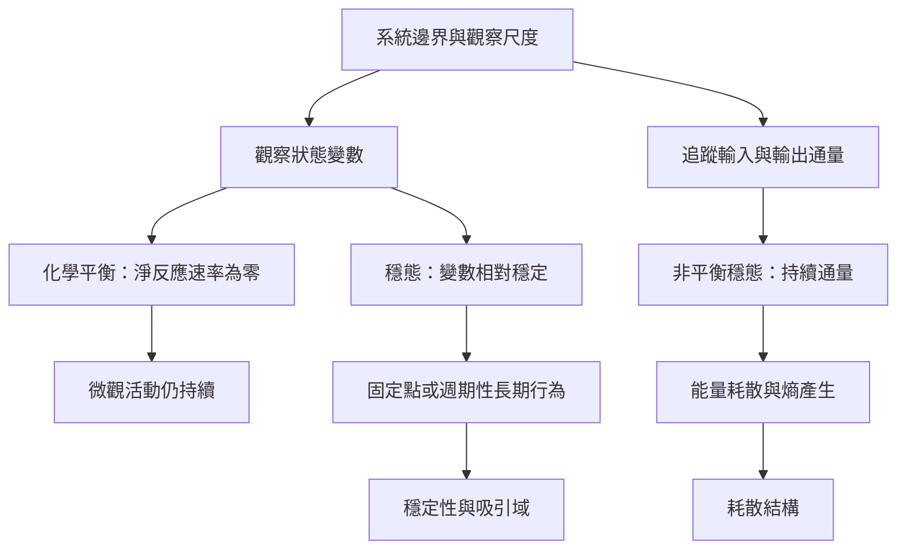

本圖譜整理動態平衡最重要的辨析：化學平衡的零淨反應速率、穩態的狀態變數穩定、非平衡穩態的持續通量，以及固定點以外的週期或複雜吸引子。理解任何一種「平衡」，都必須先說明系統邊界、觀察變數與時間尺度。

## 概念
* [[動態平衡]]
* [[化學平衡]]
* [[穩態]]
* [[非平衡穩態]]
* [[系統邊界]]
* [[存量與流量]]
* [[吸引子]]
* [[吸引域]]
* [[穩定性]]
* [[動態體制]]
* [[週期軌道]]
* [[存量]]
* [[狀態變數]]
* [[時間尺度]]
* [[觀察]]
* [[擾動]]
* [[質量作用定律]]

## 永久筆記
* [[穩定必須先說明觀察變數與系統邊界]]
* [[宏觀不變可能由微觀持續交換所維持]]
* [[零淨通量與非零通量穩態不能混為一談]]
* [[吸引子可以是週期軌道而不一定是固定點]]
* [[動態平衡的測量需要同時追蹤狀態流量與擾動]]
* [[穩態可能包含持續流動而非物質庫存完全不變]]

## 靈感筆記
* [[用小幅可逆實驗探索生活系統的調節條件]]
* [[把知識庫視為需要輸入整理與淘汰的開放系統]]
* [[把多尺度時間感帶入長期計畫]]

## 全書
* [[Dynamic_equilibrium]]

## 核心文獻
* [[正反應與逆反應速率相等時化學反應仍持續進行]]
* [[質量作用定律說明平衡源於正逆反應速率相等]]
* [[開放式教材以反應持續交換說明化學平衡]]
* [[MIT教材以李雅普諾夫方法檢驗平衡點的穩定性]]
* [[回饋控制以感測資訊修正系統偏差]]
